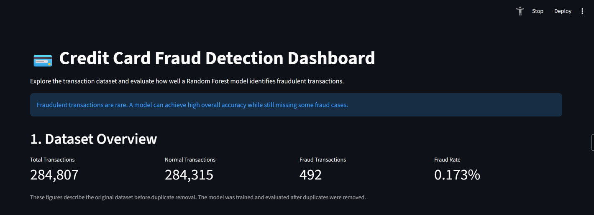

# Credit Card Fraud Detection


A machine learning project that explores credit card transaction data, addresses class imbalance using SMOTE, trains classification models, and evaluates a Random Forest fraud detection model.

The project also includes a Streamlit dashboard for exploring the dataset and viewing model performance.

## Project Overview

Credit card fraud detection is a challenging classification problem because fraudulent transactions represent a very small proportion of all transactions.

The objective of this project is to:

- Explore and understand the transaction dataset.
- Investigate class imbalance.
- Apply data preprocessing and SMOTE.
- Train and compare machine learning classification models.
- Evaluate the selected Random Forest model.
- Visualize dataset statistics and model performance through a dashboard.

## Dataset

The project uses a credit card transaction dataset containing anonymized transaction features.

The original dataset contains:

- 284,807 transactions
- 30 input features
- 1 target column (`Class`)
- 492 fraudulent transactions
- 284,315 normal transactions

The target column is:

- `0` — Normal transaction
- `1` — Fraudulent transaction

The dataset is not included in this repository because of its size.

## Dataset Source

The dataset used in this project is the Credit Card Fraud Detection
dataset hosted on Kaggle.

Dataset: https://www.kaggle.com/datasets/mlg-ulb/creditcardfraud

The dataset is not included in this repository. Download the CSV file
and place it at `data/creditcard.csv`.

### Dataset Setup

1. Obtain the original credit card fraud dataset from its source.
2. Place the CSV file in the project's `data/` directory.
3. Name the file `creditcard.csv`.

The expected path is:

```text
data/creditcard.csv
```

## Methodology

The project follows these steps:

1. Load and inspect the dataset.
2. Perform exploratory data analysis.
3. Identify and remove duplicate rows.
4. Split the data into training and testing sets using stratified sampling.
5. Apply SMOTE to the training data to address class imbalance.
6. Train and compare classification models.
7. Evaluate the selected Random Forest model on the test set.
8. Analyze feature importance and model performance.
9. Display dataset and model results using Streamlit.

SMOTE is applied only to the training data. The test data retains its original class distribution.

## Models

The project explores the following classification models:

- Logistic Regression
- Random Forest
- XGBoost

The Random Forest model was selected based on its validation performance and was evaluated on the final test dataset.

## Final Model Results

The final Random Forest model was evaluated on a test set containing 56,746 transactions, including 95 fraudulent transactions.

| Metric | Result |
|---|---:|
| Fraud Precision | 89.02% |
| Fraud Recall | 76.84% |
| Fraud F1-score | 82.49% |
| ROC-AUC | 0.9609 |
| Average Precision | 0.8043 |
| Overall Accuracy | 99.95% |

### Confusion Matrix

| | Predicted Normal | Predicted Fraud |
|---|---:|---:|
| Actual Normal | 56,642 | 9 |
| Actual Fraud | 22 | 73 |

The model correctly identified 73 fraudulent transactions, missed 22 fraudulent transactions, and incorrectly flagged 9 normal transactions as fraud.

Because the dataset is highly imbalanced, fraud-specific precision and recall are more informative than overall accuracy alone.

### Interpretation

- True Negatives: 56,642 normal transactions correctly identified.
- False Positives: 9 normal transactions incorrectly flagged as fraud.
- False Negatives: 22 fraudulent transactions missed by the model.
- True Positives: 73 fraudulent transactions correctly detected.

The model detected approximately 76.84% of fraud cases in the test set.
However, it missed 22 fraudulent transactions, which remains an
important limitation.

## Dashboard

The Streamlit dashboard provides:

- Dataset overview
- Normal vs. fraud transaction distribution
- Random Forest performance metrics
- Confusion matrix
- Fraud detected and missed counts
- Transaction amount analysis
- Key observations

The dashboard is an analysis and evaluation dashboard. It is not a deployed real-time fraud detection service.

## Project Structure

```text
credit-card-fraud-detection/
├── data/
├── assests/
├── models/
├── notebooks/
├── app.py
├── train_final_model.py
├── predict_transaction.py
├── requirements.txt
├── README.md
└── .gitignore
```

## Installation

Clone the repository:

```bash
git clone https://github.com/niyatiataldev/credit-card-fraud-detection.git
cd credit-card-fraud-detection
```

Create a virtual environment:

```bash
python -m venv .venv
```

Activate it on Windows PowerShell:

```powershell
.\.venv\Scripts\Activate.ps1
```

Install dependencies:

```bash
python -m pip install -r requirements.txt
```

Place the dataset at:

```text
data/creditcard.csv
```

## Run the Project

### Train the model

```bash
python train_final_model.py
```

This script:

- Loads and cleans the dataset.
- Splits the data.
- Applies SMOTE to the training set.
- Trains the Random Forest model.
- Evaluates the model.
- Saves the trained model under `models/`.

### Run a sample prediction

```bash
python predict_transaction.py
```

### Launch the dashboard

```bash
python -m streamlit run app.py
```
## Dashboard Preview



### Evaluation Note

The test set was used during earlier exploratory comparisons.
Therefore, the final test metrics should be interpreted as an estimate
of performance on this dataset rather than a completely independent
confirmation of generalization.

A future version should use a dedicated validation set for model
selection and reserve the test set for one final evaluation.

## Limitations

- The dataset contains anonymized features, so their real-world meanings are not available.
- The model is trained and evaluated on a historical dataset.
- The evaluation results do not guarantee performance on future transactions.
- The dashboard is not connected to a live payment system.
- The model may miss fraudulent transactions.

## Future Improvements

- Add interactive transaction prediction.
- Explore additional classification models.
- Investigate different decision thresholds.
- Improve dashboard visualizations.
- Evaluate model performance on additional datasets.
- Explore deployment options.

## Author
@Niyati Atal
Student machine learning project focused on credit card fraud detection and data science.

